<!--
  Profile README — fully static, no GitHub Actions.
  assets/*.svg are hand-made (banner, tech stack); stats cards come from external image services.
-->

  

  
  
  
  
  

###  About Me

I'm **Jihun**, a passionate embedded developer from Korea — currently a Senior R&D Engineer and team lead at **SkyAutoNet**, working on **embedded systems for autonomous driving**.

- 🌱 Currently learning **Advanced Rust** and **Software Engineering Practices**
- 🔬 Interested in **Sensor Fusion** and **MPC Control**
- ✍️ Writing book reviews & dev notes on my [Tech Blog](https://jihundev.github.io)
- ☕ Up for a chat? [Book a 30-min coffee chat](https://calendly.com/jihun-dev/30min)

### 🛠️ Tech Stack

  
  

### 📊 GitHub Stats

  
  

<b>🧩 CodeKata · Q&amp;A</b> <code>// click to expand</code>

 

  
  

  

