<!--
  Profile README — fully static, no GitHub Actions.
  Every dynamic card is rendered on request by an external image service.
-->

  

  

  
  
  
  
  

 

###  About Me

  
  

  ✍️ <a href="https://jihundev.github.io">Tech Blog</a> — book reviews &amp; dev notes &nbsp;·&nbsp; ☕ <a href="https://calendly.com/jihun-dev/30min">Book a 30-min coffee chat</a>

### 🛠️ Tech Stack

  
  

### 📊 GitHub Stats

  
  

<b>🧩 CodeKata · Q&amp;A</b> <code>// click to expand</code>

 

  
  

  

  

